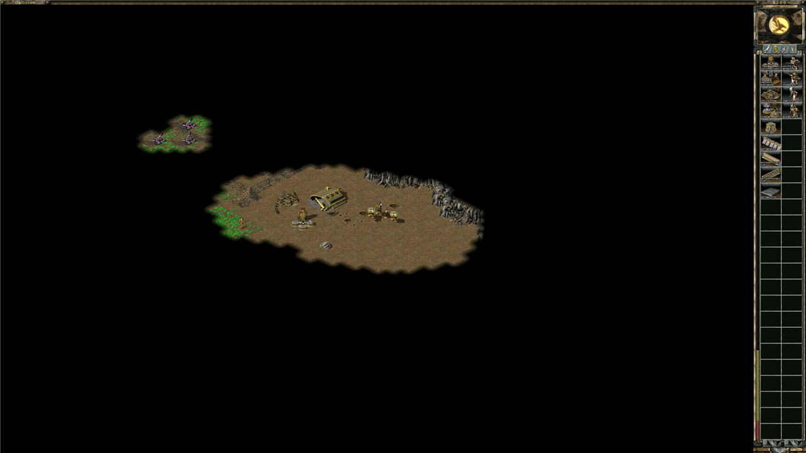
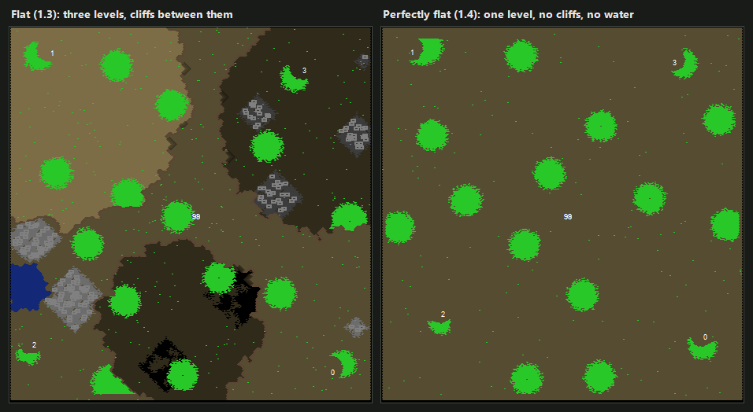
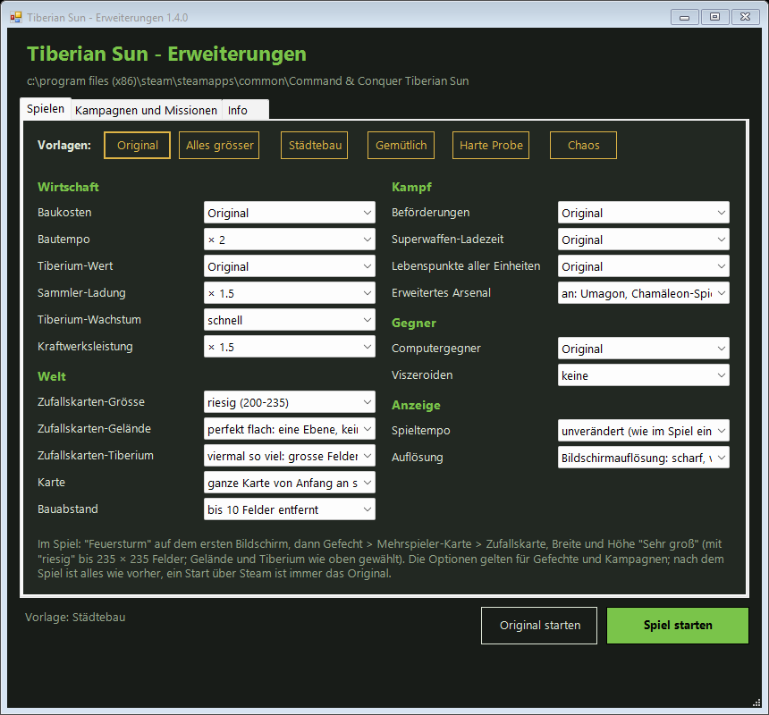
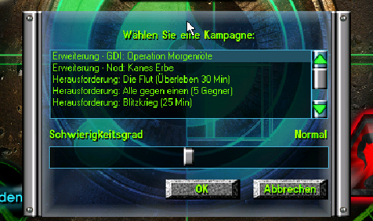

# Tiberian Sun – Erweiterungen

*[English version](README.md)*

Ein Fan-Projekt für **Command & Conquer Tiberian Sun und Feuersturm** (Steam, Game.exe 2.03 TUC): riesige
Zufallswelten, scharfe Grafik in der nativen Auflösung deines Bildschirms, 15 neue Missionen in zwei Kampagnen und
fünf Herausforderungen sowie 19 Optionen für Regeln, Welt, Gegner und Anzeige, alles in einem Startfenster.

Keine Originaldatei des Spiels wird verändert. Die Erweiterungen arbeiten über Dateien, die das Spiel zusätzlich zu
seinen eigenen liest (ein zusätzliches Archiv und neue Missionsdateien), und über den Arbeitsspeicher des laufenden
Spiels. Wenn das Spiel endet, ist alles wieder wie vorher; ein Start über Steam ist immer das Original. Nur für das
Einzelspiel.

<p align="center">
  
</p>

## Was es kann

| Funktion | Was du bekommst |
|---|---|
| **Riesige Zufallswelten** | Der eingebaute Zufallskarten-Generator des Spiels macht Karten bis **235 × 235 Felder** (Original: höchstens 175 × 175, und das nur mit 8 Spielern; mit 4 Spielern 128 × 128) – mit Flüssen, Klippen, Tiberium, Wäldern und Ruinen. |
| **Flaches Land für ganze Städte** | Option *Zufallskarten-Gelände: perfekt flach* – die ganze Karte auf einer Ebene: keine Klippen, kein Wasser, keine Ruinen, wenig Bäume (gemessen auf 225 × 225: 98 % bebaubar, alles an einem Stück). *flach* – kaum Hügel, wenig Wasser, ein paar grosse Hochebenen: gemessen auf 225 × 225 sind 92 % der Karte bebaubar (mit den üblichen Reglern 59 %). Oder *zerklüftet*: viele Hochebenen, Hügel und Pässe. |
| **Städtebau** | *Karte: ganze Karte von Anfang an sichtbar* (nichts Schwarzes, Unerforschtes), *Bauabstand* bis 6 oder 10 Felder von deiner Basis (Original: 2), *Viszeroiden: keine*. Meteoriten und Nebel des Krieges sind auf Zufallskarten ohnehin aus; Ionenstürme nur mit dem Häkchen *Ionensturm* im Zufallskarten-Dialog. |
| **Genug Tiberium** | Der Generator gibt jeder Karte gleich viel Tiberium, egal wie gross sie ist – auf einer Riesenkarte ist es dünn verteilt. Option *Zufallskarten-Tiberium*: doppelt oder viermal so viel, in den Feldern und bei jedem Startpunkt (gemessen: 4,5-mal so viele Tiberium-Felder). Mit *Tiberium-Wachstum* wächst es schneller nach. |
| **Stärkere Gegner** | *Computergegner stark / brutal*: mehr Geld, mehr und frühere Angriffe, harte Verteidigung ihrer Basis – und sie reparieren **alle** beschädigten Gebäude gleichzeitig (das Original repariert eines nach dem anderen und wartet dazwischen) und **verkaufen nie** ihre Gebäude, wenn das Geld knapp wird. |
| **Scharfe Grafik** | Das Spiel läuft in der nativen Auflösung deines Bildschirms (z. B. 2560 × 1440) – keine verzerrten, unscharfen Pixel mehr, und du siehst viel mehr vom Schlachtfeld. Die Seitenleiste reicht über die ganze Bildschirmhöhe, mit bis zu 40 Bauzeilen (Original: 20 – mehr Zeilen liessen das Spiel abstürzen). |
| **Spieltempo** | 60, 30 oder 20 Bilder pro Sekunde, oder unbegrenzt; standardmässig unverändert. Auf „unbegrenzt“ läuft die Steam-Version mit 120 Bildern/s – achtmal so schnell wie das klassische Tempo –, auch auf einer 235 × 235-Karte mit 8 Spielern (gemessen). Mitten im Gefecht: Esc → *Spielsteuerung* → *Spielgeschwindigkeit*. |
| **Neue Kampagnen** | *Operation Morgenröte* (GDI, 5 Missionen) und *Kanes Erbe* (Nod, 5 Missionen): Eroberung, Überleben, Kommando, Verteidigung und Wirtschaft, mit Gegnerbasen, die wie die Gefechts-KI bauen und angreifen, und Angriffswellen, die mit der Zeit und dem Schwierigkeitsgrad wachsen. |
| **Herausforderungen** | Die Flut (30 Min überleben), Alle gegen einen (5 Gegner), Blitzkrieg (25 Min), Wirtschaftswunder (100 000 Credits), Eiswüste (Riesenkarte, 6 Gegner). |
| **Regel-Optionen** | Baukosten, Bautempo, Tiberium-Wert und -Wachstum, Sammler-Ladung, Kraftwerksleistung, Beförderungen, Superwaffen-Ladezeit, Lebenspunkte, erweitertes Arsenal (Umagon, Chamäleon-Spion, Helden bis 3-mal), Bauabstand, starke oder brutale Computergegner. |
| **Vorlagen** | Original, Alles grösser (riesig, flach, Tiberium × 4), Städtebau (riesig, perfekt flach, Tiberium × 4, ganze Karte sichtbar, Bauabstand 10), Gemütlich, Harte Probe (zerklüftet, brutal), Chaos. |

<p align="center">
  
</p>

<p align="center">
  
  
</p>

## Installieren

Du brauchst **Command & Conquer Tiberian Sun und Feuersturm** von Steam und Windows 10/11.

**Mit einer Zeile** (PowerShell):

```powershell
irm https://raw.githubusercontent.com/MisterDeeds/tiberian-sun-extensions/main/get.ps1 | iex
```

**Oder** das [neueste Release](https://github.com/MisterDeeds/tiberian-sun-extensions/releases/latest) herunterladen,
entpacken und `install.cmd` doppelklicken.

Der Installer kopiert das Werkzeug nach `%LOCALAPPDATA%\Programs\TSExtensions`, baut die Missionen aus den Karten
*deiner* Installation (auf Deutsch bei einem deutschen Windows, sonst auf Englisch), kopiert sie in den Spielordner
und legt die Verknüpfung **Tiberian Sun - Erweiterungen** auf dem Desktop und im Startmenü an. Entfernen mit
`uninstall.cmd` oder unter Windows *Einstellungen > Apps*.

**Updates kommen von selbst:** Bei jedem Start fragt der Starter GitHub nach der neusten Version, installiert sie und
öffnet sich wieder (Häkchen *Automatisch aktualisieren* oben rechts, standardmässig an; nie während das Spiel läuft,
deine Einstellungen bleiben). Die Versionen 1.0 und 1.1 haben noch keine Update-Prüfung: einmal mit der Zeile oben
installieren.

## Spielen

1. **Tiberian Sun - Erweiterungen** starten, eine Vorlage oder eigene Optionen wählen, **Spiel starten** klicken.
2. Im Spiel auf dem ersten Bildschirm **Feuersturm** anklicken.
3. **Riesige Welten:** Gefecht > Mehrspieler-Karte > Zufallskarte, Kartenbreite und -höhe *Sehr groß*
   (mit der Option *riesig*: 200–235 Felder pro Seite; *gross*: bis 220). Mit den Optionen *Gelände* und *Tiberium*
   stehen die Regler dort auf deren Werten; du kannst sie weiter verschieben.
4. **Neue Kampagnen:** Neuer Feldzug > einen Eintrag mit *Erweiterung* oder *Herausforderung* wählen.
   Der Schwierigkeitsgrad bestimmt Grösse und Häufigkeit der feindlichen Angriffswellen.

## Wie es funktioniert

Alles wurde durch Reverse Engineering der Steam-`Game.exe` (2.03 TUC) mit Ghidra gefunden; Adressen, Dateiformate und
Messungen im Spiel stehen in [docs/FINDINGS.md](docs/FINDINGS.md).

- **Zufallskarten-Grösse** – der Generator berechnet die Kartengrösse aus vier Tabellen (je 7 Einträge, für 2–8
  Spieler). Das Werkzeug schreibt grössere Werte in diese Tabellen im Speicher des laufenden Spiels (vorher geprüft:
  nur wenn dort die Originalwerte stehen).
- **Native Auflösung und Seitenleiste über die ganze Höhe** – die Seitenleiste hat Platz für 2 × 20
  Bau-Schaltflächen. Ab etwa 1214 Pixeln Bildschirmhöhe rechnet das Spiel mit mehr Zeilen, schreibt über das Feld
  hinaus und stürzt beim Start eines Gefechts ab. Das Werkzeug verlegt das Feld in neuen Speicher mit Platz für
  2 × 40 Zeilen: Es schreibt die 11 Befehle um, die seine Adresse enthalten, verdoppelt den Spaltenabstand an den
  7 Stellen, die „Zeile + Spalte × 20“ rechnen, und begrenzt die Höhe der Seitenleiste auf 40 Zeilen. Dann
  funktioniert jede Auflösung bis 2160 Pixel Höhe, mit einer Seitenleiste von oben bis unten.
- **Zufallskarten-Gelände und -Tiberium** – die Regler des Zufallskarten-Dialogs zeigen Felder des
  Generator-Objekts im Speicher (beim Spielstart Spieler 2, alles andere 0); das Werkzeug setzt sie, bevor du den
  Dialog öffnest. Der Generator verteilt `(Tiberium-Regler × 30 + 2500) × Spieler` Felder Tiberium auf
  `Felder-Regler ÷ 10 + Spieler + 3` Felder, dazu etwa 500 bei jedem Startpunkt – unabhängig von der Kartengrösse.
  Zwei kleine Hooks vervielfachen beide Mengen.
- **Perfekt flach** – jedes Feld beginnt auf derselben Höhe. Danach teilt der Generator jede grosse Fläche und setzt
  jeden Teil 4 Stufen über oder unter seine Nachbarn – daher kommen die Klippen, auch mit dem Klippen-Regler ganz
  rechts. Ein Patch von einem Byte überspringt das Teilen, die Karte bleibt auf einer Ebene.
- **Ganze Karte sichtbar, keine Viszeroiden** – das Werkzeug ruft im ersten Bild eines Gefechts die spieleigene
  Funktion *Karte aufdecken* auf (die der Aufdeck-Kiste) und macht aus dem Viszeroiden-Test nach dem Tod eines
  Infanteristen im Tiberium einen Sprung. Die Regel-Schlüssel für Meteoriten, Viszeroiden und Nebel des Krieges liest
  das Spiel nie; das sind Schalter jeder Karte.
- **Computergegner** – Regelwerte, die das Spiel wirklich verwendet (mehrere `[AI]`-Einträge liest es zwar, verwendet
  sie aber nie, z. B. `PowerEmergency`, `BaseSizeAdd`, `WarLimit`), und ein Speicher-Patch: Ein Computerhaus beginnt
  eine Reparatur nur, wenn sein „repariert gerade“-Merker frei ist, also immer nur ein Gebäude; der Patch entfernt
  diese Prüfung. `[IQ] SellBack=99` beendet das Verkaufen, `CreditReserve=0` lässt sie auch mit wenig Geld reparieren.
- **Zeiten in Missionen** – Wellen, Countdowns und Zeitlimits laufen in Spielzeit (Spielbilder ÷ 15), wie in den
  Originalmissionen, und folgen damit dem Spieltempo.
- **Regel-Optionen** – eine geänderte Kopie deiner eigenen `FIRESTRM.INI` kommt in das Archiv `EXPAND99.MIX`. Das
  Spiel sucht in Archiven vor losen Dateien und lädt `EXPAND99` vor `EXPAND01` von Feuersturm, also gewinnt die
  Kopie. Das Archiv wird entfernt, wenn das Spiel endet.
- **Kampagnen** – das Spiel nimmt jede `BATTLE*.INI` seines Ordners in die Kampagnenliste auf. Die Missionen
  (`TSX*.MAP`) werden bei der Installation aus den offiziellen Mehrspieler-Karten deiner Installation gebaut:
  Gelände aus der Originalkarte, dazu Häuser, Basen auf flachem bebaubarem Boden (geprüft mit den Kachelvorlagen des
  Geländes), Einheiten, Trigger, Teams und Angriffswellen.

Nichts vom Spiel liegt in diesem Repository – nur Code und Dokumentation. Das Spiel wird aus deiner Installation
gelesen.

## Hinweise

- Nur für die Steam-Version mit `Game.exe` 2.03 TUC (SHA-256 `58CFDBA4…AE17DB3`). Bei einer anderen Version werden die
  Speicher-Patches übersprungen (das Werkzeug bleibt dann bei einer Auflösung, die ohne sie funktioniert); Optionen
  und Kampagnen funktionieren trotzdem.
- Die Regel-Optionen gelten für Feuersturm-Spiele: Gefechte im Feuersturm-Modus, Feuersturm-Missionen und die neuen
  Kampagnen.
- Missionen zählen in Spielzeit: Bei 120 Bildern/s dauert ein „20-Minuten“-Countdown 2,5 echte Minuten. Für ein
  ruhigeres Tempo unter *Spieltempo* 60 oder 30 Bilder/s wählen.
- Riesenkarten brauchen mehr Rechenleistung; mit 8 Spielern auf 235 × 235 kann das Spiel gegen Ende langsamer werden.
- Nur für das Einzelspiel. Online- und LAN-Spiele bleiben unberührt, wenn du das Spiel ohne dieses Werkzeug startest.

## Entwicklung

`tests\test-missions.ps1`, `tests\test-rules.ps1`, `tests\test-patches.ps1` und `tests\test-install.ps1` prüfen die
Missionen, die Regeldatei, jeden Speicher-Patch gegen deine `Game.exe` und eine vollständige Installation und
Entfernung in einer Sandbox, samt der Update-Logik des Starters und dem Einzeiler-Installer mit einem ZIP im Aufbau
eines GitHub-Releases. In `dev\` liegen die Analysewerkzeuge: Ghidra-Skripte, Kartenzeichner, Spiel-Sonde, ein
automatischer Missionstest, der das Spiel startet, sich durch die Menüs klickt und prüft, dass die Spiellogik läuft,
`rmg-survey.ps1` / `rmg-stats.ps1` (erzeugen Zufallskarten im Spiel und messen Gelände und Tiberium) und
`launcher-game-test.ps1` (der Starter von Anfang bis Ende), `speed-test.ps1` (Bilder pro Sekunde auf einer
Riesenkarte) und `run-when-idle.ps1` (startet diese Tests nur, solange niemand den PC benutzt, und bricht bei der
ersten Maus- oder Tasten-Eingabe ab – auf einem unsichtbaren Desktop läuft das Spiel nicht).

Fan-Projekt, nicht mit Electronic Arts verbunden. Command & Conquer, Tiberian Sun und Firestorm sind Marken von
Electronic Arts Inc. MIT-Lizenz.
