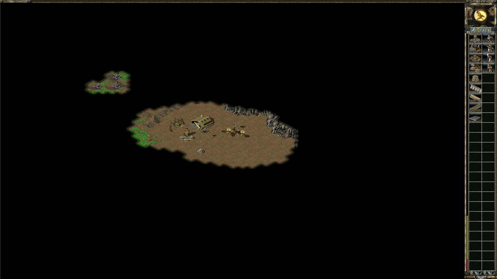
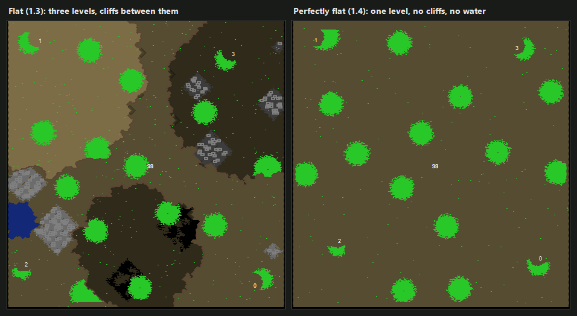
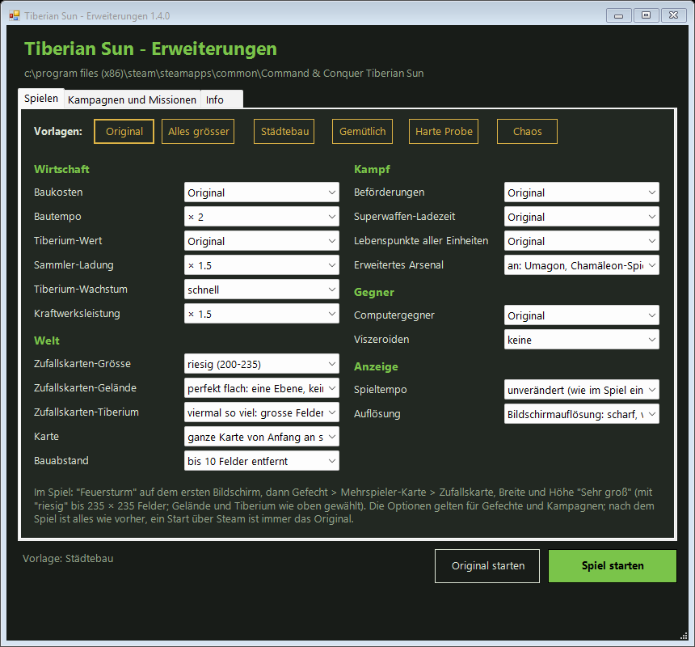

# Tiberian Sun – Extensions

*[Deutsche Version](README.de.md)*

A fan project for **Command & Conquer Tiberian Sun and Firestorm** (Steam, Game.exe 2.03 TUC): huge random worlds,
sharp graphics in your screen's native resolution, 15 new missions in two campaigns and five challenges, and
19 options for rules, world, enemies and display, all in one start window.

No original game file is changed. The extensions work through files the game reads in addition to its own (an extra
archive and new mission files) and through the memory of the running game. When the game ends, everything is as
before; a game started from Steam is always the original. Single player only.

<p align="center">
  
</p>

## What it does

| Feature | What you get |
|---|---|
| **Huge random worlds** | The game's own random map generator makes maps up to **235 × 235 cells** (original: at most 175 × 175, and only with 8 players; 128 × 128 with 4 players) – with rivers, cliffs, tiberium, forests and ruins. |
| **Flat land for whole cities** | Option *Random map terrain: perfectly flat* – the whole map on one level: no cliffs, no water, no ruins, few trees (measured on 225 × 225: 98 % buildable, all of it in one piece). *flat* – hardly any hills, little water, a few big plateaus: measured on 225 × 225, 92 % of the map is buildable (59 % with the usual sliders). Or *rugged*: many plateaus, hills and passes. |
| **City building** | *Map: whole map visible from the start* (no black, unexplored land), *Build distance* up to 6 or 10 cells from your base (original: 2), *Visceroids: none*. Meteorites and fog of war are off on random maps anyway; ion storms only if you tick *Ion storm* in the random map dialog. |
| **Plenty of Tiberium** | The generator gives a map the same amount of Tiberium however big it is – on a huge map it is thin. Option *Random map Tiberium*: twice or 4 times as much, in the fields and next to every start position (measured: 4.5 times as many Tiberium cells). With *Tiberium growth* it grows back faster. |
| **Tougher opponents** | *Computer opponents strong / brutal*: more money, more and earlier attacks, a fierce defense of their base – and they repair **every** damaged building at once (the original repairs one at a time and then waits) and **never sell** their buildings when money runs short. |
| **Sharp graphics** | The game runs in your screen's native resolution (e.g. 2560 × 1440) – no more stretched, blurry pixels, and you see much more of the battlefield. The sidebar fills the whole screen height with up to 40 build rows (original: 20 – more rows crashed the game). |
| **Game speed** | 60, 30 or 20 frames per second, or unlimited; by default unchanged. On "unlimited" the Steam version runs at 120 frames/s – eight times the classic speed – also on a 235 × 235 map with 8 players (measured). During a battle: Esc → *Game controls* → *Game speed*. |
| **New campaigns** | *Operation Dawn* (GDI, 5 missions) and *Kane's Legacy* (Nod, 5 missions): conquest, survival, commando, defense and economy missions with enemy bases that build and attack like the skirmish AI, attack waves that grow with time and difficulty. |
| **Challenges** | The Flood (survive 30 min), All Against One (5 enemies), Blitz (25 min), Economic Miracle (100,000 credits), Ice Desert (huge map, 6 enemies). |
| **Rules options** | Build costs, build speed, tiberium value and growth, harvester load, power output, promotions, super weapon charge time, unit hit points, extended arsenal (Umagon, Chameleon spy, heroes up to 3 times), build distance, stronger or brutal computer opponents. |
| **Presets** | Original, Everything bigger (huge, flat, 4 × Tiberium), City builder (huge, perfectly flat, 4 × Tiberium, whole map visible, build distance 10), Relaxed, Hard test (rugged, brutal), Chaos. |

<p align="center">
  
</p>

<p align="center">
  
  
</p>

## Install

You need **Command & Conquer Tiberian Sun and Firestorm** from Steam and Windows 10/11.

**One line** (PowerShell):

```powershell
irm https://raw.githubusercontent.com/MisterDeeds/tiberian-sun-extensions/main/get.ps1 | iex
```

**Or** download the [latest release](https://github.com/MisterDeeds/tiberian-sun-extensions/releases/latest),
unpack it and double-click `install.cmd`.

The installer copies the tool to `%LOCALAPPDATA%\Programs\TSExtensions`, builds the missions from the maps of *your*
installation (in German on a German Windows, otherwise in English), copies them into the game folder, and creates the
shortcut **Tiberian Sun - Extensions** on the desktop and in the Start menu. Remove it again with `uninstall.cmd` or
under Windows *Settings > Apps*.

**Updates come by themselves:** at every start the launcher asks GitHub for the newest version and installs it, then
opens again (check box *Update automatically* at the top right, on by default; never while the game runs, your
settings stay). Versions 1.0 and 1.1 have no update check yet: install once with the line above.

## Play

1. Start **Tiberian Sun - Extensions**, pick a preset or your own options, click **Start game**.
2. In the game, click **Firestorm** on the first screen.
3. **Huge worlds:** Skirmish > Multiplayer map > Random map, set map width and height to *Very large*
   (with the option *huge*: 200–235 cells per side; *large*: up to 220). With the options *terrain* and *Tiberium*
   the sliders there start at their values; you can still move them.
4. **New campaigns:** New campaign > choose an entry starting with *Extension* or *Challenge*.
   The difficulty slider sets the size and frequency of the enemy attack waves.

## How it works

Everything was found by reverse engineering the Steam `Game.exe` (2.03 TUC) with Ghidra; addresses, file formats and
in-game measurements are in [docs/FINDINGS.md](docs/FINDINGS.md).

- **Random map size** – the generator computes the map size from four tables (7 entries each, for 2–8 players).
  The tool writes larger values into these tables in the memory of the running game (checked first: only if the
  original values are there).
- **Native resolution and full-height sidebar** – the sidebar has room for 2 × 20 build buttons. At more than about
  1214 pixels screen height the game computes more rows, overflows the array and crashes when a battle starts. The tool
  moves the button array to new memory with room for 2 × 40 rows: it rewrites the 11 instructions that hold its
  address, doubles the column stride in the 7 places that compute "row + column × 20", and limits the sidebar
  height to 40 rows. Then any resolution up to 2160 pixels height works with a sidebar from top to bottom.
- **Random map terrain and Tiberium** – the sliders of the random map dialog show fields of the generator object in
  memory (players 2, everything else 0 when the game starts); the tool sets them before you open the dialog. The
  generator gives `(Tiberium slider × 30 + 2500) × players` cells of Tiberium fields, spread over
  `fields slider ÷ 10 + players + 3` fields, plus about 500 next to every start position – whatever the map size.
  Two small hooks multiply both amounts.
- **Perfectly flat** – every cell starts on one level. The generator then splits every big area and puts each part
  4 levels above or below its neighbours – that is where the cliffs come from, even with the cliff slider at the
  flattest setting. A one-byte patch skips the split, so the map stays on one level.
- **Whole map visible, no visceroids** – the tool calls the game's own *reveal map* function (the one of the reveal
  crate) in the first frame of a battle, and turns the visceroid test after an infantry death in Tiberium into a jump.
  The rules keys for meteorites, visceroids and fog of war are never read by the game; they are flags of each map.
- **Computer opponents** – rules values the game really uses (several `[AI]` keys are read but never used, e.g.
  `PowerEmergency`, `BaseSizeAdd`, `WarLimit`) and one memory patch: a computer house starts a repair only while its
  "repairing" flag is clear, so one building at a time; the patch removes that test. `[IQ] SellBack=99` ends the
  selling, `CreditReserve=0` lets them repair even with little money.
- **Mission timing** – waves, countdowns and time limits use game time (game frames ÷ 15), like the original
  missions, so they follow the game speed.
- **Rules options** – a changed copy of your own `FIRESTRM.INI` goes into the archive `EXPAND99.MIX`. The game searches
  archives before loose files and loads `EXPAND99` before Firestorm's `EXPAND01`, so the copy wins. The archive is
  removed when the game ends.
- **Campaigns** – the game adds every `BATTLE*.INI` of its folder to the campaign list. The missions (`TSX*.MAP`) are
  built at install time from the official multiplayer maps of your installation: terrain from the original map,
  plus houses, bases on flat buildable ground (checked against the tile templates of the theater), units, triggers,
  teams and attack waves.

Nothing of the game is in this repository – only code and documentation. The game is read from your installation.

## Notes

- Only for the Steam version with `Game.exe` 2.03 TUC (SHA-256 `58CFDBA4…AE17DB3`). With another version the memory
  patches are skipped (the tool then stays at a resolution that works without them); options and campaigns still work.
- The rules options apply to Firestorm games: skirmish in Firestorm mode, Firestorm missions and the new campaigns.
- Missions count in game time: at 120 frames/s a "20 minute" countdown takes 2.5 real minutes. Pick 60 or 30
  frames/s under *Game speed* for a calmer pace.
- Huge maps need more computing power; with 8 players on 235 × 235 the game can get slower late in the battle.
- Single player only. Online and LAN games are not touched when you start the game without this tool.

## Development

`tests\test-missions.ps1`, `tests\test-rules.ps1`, `tests\test-patches.ps1` and `tests\test-install.ps1` check the
missions, the rules file, every memory patch against your `Game.exe`, and a complete install/remove in a sandbox,
including the launcher's update logic and the one-line installer with a ZIP in the layout of a GitHub release.
`dev\` has the analysis tools: Ghidra scripts, map renderer, game probe, an automatic mission test that starts the
game, clicks through the menus and checks that the game logic runs, `rmg-survey.ps1` / `rmg-stats.ps1` (generate
random maps in the game and measure terrain and Tiberium), `launcher-game-test.ps1` (the launcher end to end) and
`speed-test.ps1` (frames per second on a huge map) and `run-when-idle.ps1` (runs these in-game tests only while`nnobody uses the PC and stops at the first mouse or key press – the game cannot run on an invisible desktop).

Fan project, not affiliated with Electronic Arts. Command & Conquer, Tiberian Sun and Firestorm are trademarks of
Electronic Arts Inc. MIT license.
